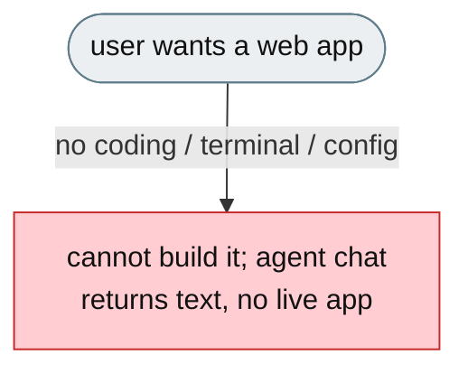
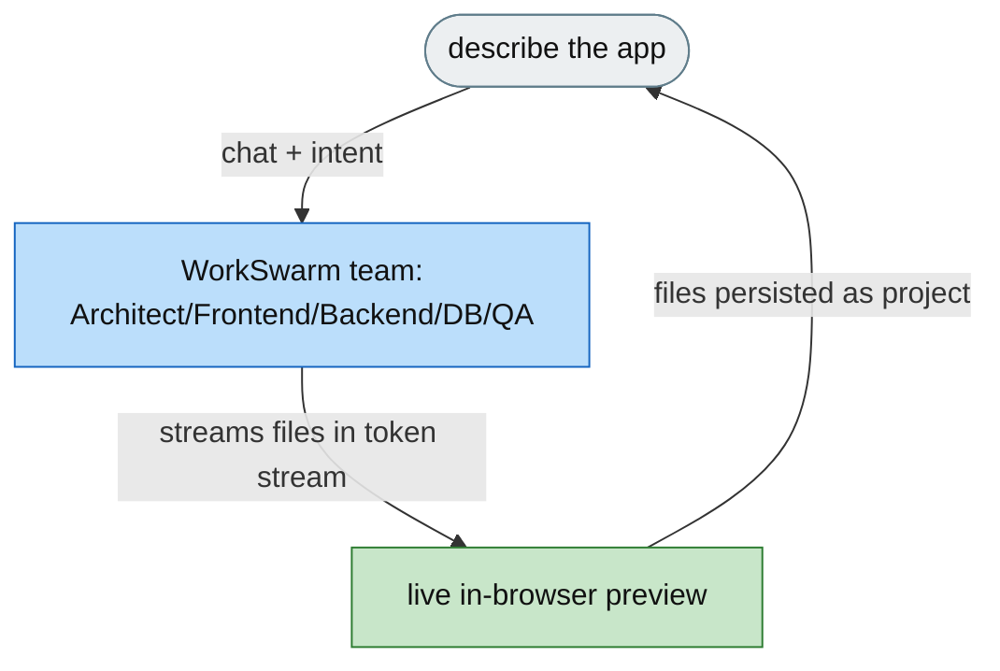
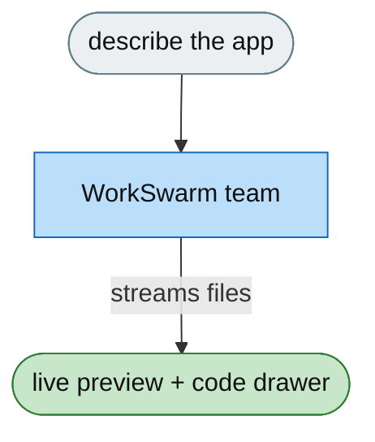

**[Feature]: Implement VibeStudio — a Natural-Language Full-Stack App Builder Powered by WorkSwarm / 实现 VibeStudio——由 WorkSwarm 驱动的自然语言全栈应用构建器**

EN ======
Building a web app normally requires a terminal, configuration, and coding knowledge. VibeStudio lets a user describe what they want in natural language, a coordinated WorkSwarm agent team writes the code, and a live in-browser preview appears immediately — no terminal, no config, no prior coding knowledge.

ZH ======
构建 Web 应用通常需要终端、配置与编码知识。VibeStudio 让用户以自然语言描述需求，由协调一致的 WorkSwarm 智能体团队编写代码，并立即出现浏览器内的实时预览——无需终端、无需配置、无需任何编码经验。

---

# [Feature]: VibeStudio — build full-stack web apps through natural-language conversation, powered by WorkSwarm

## Executive Summary

Building a full-stack web app normally requires a terminal, configuration, and coding knowledge. VibeStudio removes that: a user describes what they want in natural language, a coordinated WorkSwarm agent team writes the code, and a live in-browser preview appears immediately. It is a thin browser client over the WorkSwarm runtime, using `@jiuwenswarm/sdk` as its sole transport layer — no terminal, no config, no prior coding knowledge required.

## Background Description

Most people who want a small web app — a landing page, a dashboard, a todo app — cannot build one. The alternatives are a code editor and terminal (out of reach), a low-code tool (limited to its own widgets), or hiring a developer (slow and costly). Existing agent chat tools produce code but no live preview and no working multi-file project; the output is text, not a running app. There is no surface where a non-developer can describe an app, have a team of agents build it, and see it running — all in one place.

## Design Ideas

### Proposed design

A browser SPA (VibeStudio) over the WorkSwarm agent team:

- **Chat panel** — live streaming token output with quick-action buttons (Generate / Fix / Explain / Refactor). Mode selection (`team` vs `agent`) is inferred from intent.
- **Live preview** — the generated React/TypeScript/Tailwind app is bundled offline by the dev server (esbuild) and rendered in-browser (Sandpack), so it works without reaching an external service.
- **Code drawer** — a file explorer and editor side-by-side beneath the preview; clicking a file opens it, without squeezing the preview sideways.
- **Swarm activity inline** — a collapsible, real-time per-agent activity feed that opens while agents work and closes when they finish.
- **Template picker** — 6 ready-made starters (counter, todo, landing page, dashboard, Kanban, chat UI, auth form).
- **Session = project** — generated files persist to `localStorage`, so closing and reopening restores the last state without regenerating. ZIP and Markdown export are built in.

Agent output embeds files in the token stream via `@@FILE: path … @@END_FILE` sentinel markers; `streamParser` extracts and applies them as file deltas, with `@@DELETE: path` for deletions.

## Involved Public APIs

New components (the `jiuwenswarm-vibestudio` SPA):

| API | Kind |
|---|---|
| `RpcClient` (over `@jiuwenswarm/sdk`) | new class (WebSocket, sessions, streamEvents, rewind) |
| `streamParser` | new module (`@@FILE…@@END_FILE` / `@@DELETE` extraction) |
| `agentMode` / `inferIntent` | new module (mode selection + intent detection) |
| Zustand stores (`project`, `session`, `layout`, `theme`) | new stores (files, chat, agent log, rewind stack, persistence) |
| `SandpackPreview`, `FileTree`, `SwarmActivity`, `ChatPanel`, `TemplateModal`, `ReconnectToast` | new components |

**Impact:** additive — a thin client over `@jiuwenswarm/sdk`. The WorkSwarm server and agent team are unchanged; generated files live in the browser.

## Description of Relevance to Other Modules

- **`src/lib/client.ts`** — the sole transport layer to WorkSwarm via `@jiuwenswarm/sdk`.
- **`src/lib/streamParser.ts`** — turns the agent's sentinel-marked token stream into project file deltas.
- **`src/store/`** — project/session/layout/theme state, persisted to `localStorage`.
- **`src/components/Preview/`** — offline bundled live preview (Sandpack) and code drawer.
- **`@jiuwenswarm/sdk`** — the shared communication layer (also used by the browser, JupyterLab, and IDE channels).

## Test Design and Test Plan

Unit/integration tests:

1. **Stream parsing** — `@@FILE` extraction, `@@DELETE`, whitespace handling, and embedded file deltas.
2. **Intent/mode detection** — `generate` → `team`, `refine`/`explain`/`fix` → `agent`; quick-action overrides.
3. **Project store** — chat messages, agent log, rewind, and reset behave correctly.
4. **Session persistence** — project files survive a reload via `localStorage`; session CRUD and active-project tracking work.
5. **Preview** — a generated React/TypeScript app renders in the live preview from the offline bundle.
6. **Export** — ZIP and Markdown chat export produce the expected output with sanitised filenames.

Performance/reliability:

- **Reconnect toast** — a disconnection banner auto-dismisses when the WebSocket recovers.

## Additional Information

## Solution

**What type of PR is this?**
/kind feature

---

## **What does this PR do / why do we need it**

This PR adds VibeStudio — a browser SPA that builds full-stack web apps from natural-language descriptions, powered by a coordinated WorkSwarm agent team, with a live in-browser preview.

---

## **Problem**

Building a web app requires a terminal, configuration, and coding knowledge. Existing agent chat tools return code as text, with no live preview and no working multi-file project — leaving non-developers unable to go from idea to running app.

---

## **Solution**

A thin SPA over WorkSwarm: a chat panel, an offline live preview (Sandpack + esbuild), a code drawer, inline swarm activity, a template picker, and per-session project persistence — the session IS the project.

---

## **Expected Impact**

- Non-developers can build full-stack apps from natural language.
- A live preview appears immediately — no terminal, no config.
- Projects persist and can be exported (ZIP / Markdown).
- WorkSwarm agents become accessible through a no-code surface.

---

## **Self-checklist**

- [x] **Design**: SPA + WorkSwarm architecture reviewed against the RAT
- [x] **Test**: Stream parsing, intent detection, stores, persistence, preview, and export covered
- [x] **Verification**: Confirmed offline preview and session restore
- [ ] **Interface**: No change to the WorkSwarm server or agent team
- [x] **Document**: Full documentation added
